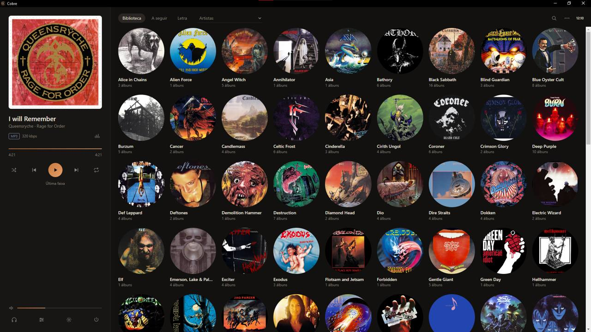

<div align="center">
  
  <br>
  
  <h1>Cobre Desktop</h1>
  <p>Reprodutor de música local para Windows</p>
  <p><strong>Versão 3.8.0</strong></p>
</div>

Desenvolvimento principal: Bruno C S Moraes · Contribuição ao projeto: [@dilucas00](https://github.com/dilucas00).

## Downloads

Os pacotes públicos mais recentes estão na [página de lançamento](https://github.com/bruncosta077-boop/Cobre/releases/tag/cobre-desktop-v3.8.0).

- **Instalador:** `Cobre-3.8.0-x64.exe`
- **Versão portátil:** `Cobre-3.8.0-x64.zip`
- **Atualização dentro do app:** `Cobre-Update-v3.8.0-x64.zip` — atualiza instalações empacotadas e portáteis descompactadas a partir da versão 3.6.0.

## Sobre o projeto

Este repositório contém somente o código-fonte do Cobre Desktop. O aplicativo usa Electron e toca a biblioteca de música local no Windows.

## Executar o código-fonte

Requer Node.js e npm:

```powershell
npm install
npm start
```

Para gerar o instalador e a versão portátil:

```powershell
npm run dist
```

Os pacotes são gerados na pasta `release/`.

## Atualização dentro do app

Acesse **Configurações → Manutenção → Atualizar Cobre**. O app consulta as releases do GitHub, mostra as notas, verifica o SHA-256 e atualiza instalações empacotadas em `app.asar` ou portáteis descompactadas, com cópia de segurança e tentativa de recuperação em falha. Instalações 3.5.0 precisam atualizar para 3.6.0 uma vez pelo instalador ou ZIP portátil; depois disso o atualizador interno passa a funcionar. As preferências da 3.5 também são migradas para o armazenamento seguro da 3.7.

## Ecossistema Cobre

- [Cobre Mobile](https://github.com/bruncosta077-boop/Cobre-Mobile) — cliente Android em pré-release de desenvolvimento; conexão LAN e reprodução básica já existem, enquanto recursos Mobile e assinatura estável continuam em evolução.
- [Cobre Server](https://github.com/bruncosta077-boop/Cobre-Server) — serviço Cobre ID para contas, sessões, dispositivos e pareamento inicial.
- [Cobre TV](https://github.com/bruncosta077-boop/Cobre-TV) — protótipo 0.1.0 em desenvolvimento separado; ainda não pareia, lê a biblioteca do Desktop ou reproduz faixas reais.

O streaming integrado entre Desktop, Mobile e TV e a sincronização da biblioteca ainda não estão disponíveis. A presença de dispositivos e a conta Cobre ID, por si só, não dão acesso à música do computador em outros aparelhos.

## Segurança do acesso remoto

O acesso remoto do Desktop transmite a biblioteca diretamente pela rede local em HTTP. O endereço completo contém uma chave de acesso; trate-o como uma senha e compartilhe somente com aparelhos confiáveis na mesma rede. O conteúdo e a chave não são criptografados no Wi-Fi. Não encaminhe a porta do Cobre à internet nem use redes públicas. Para acesso fora de casa, use uma VPN privada confiável.

## Licença

O projeto não declara uma licença de redistribuição. Consulte o autor antes de reutilizar ou redistribuir o código.
